# ¿Qué hay en la foto?

Tomas una foto con el teléfono, la subes, y en un par de segundos la aplicación te dice qué ve en ella, con un porcentaje al lado de cada cosa. La foto queda guardada en un bucket de Cloud Storage y aparece en una galería con las últimas fotos del grupo. Quien reconoce lo que hay en la imagen no es código tuyo: es Cloud Vision, un modelo que Google ya entrenó y que se usa con una petición HTTP.

La plantilla trae las dos aplicaciones completas y la infraestructura del frontend y el backend. Tu grupo construye en Terraform el bucket, el permiso del backend sobre él y el acceso a Vision.

| Sin bucket todavía | Con etiquetas | La galería |
|---|---|---|
| 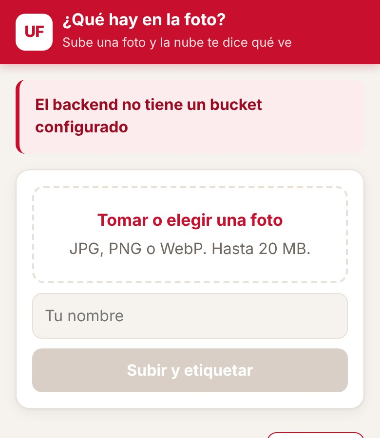 | 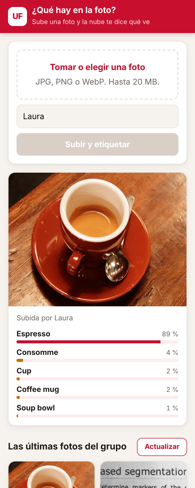 | 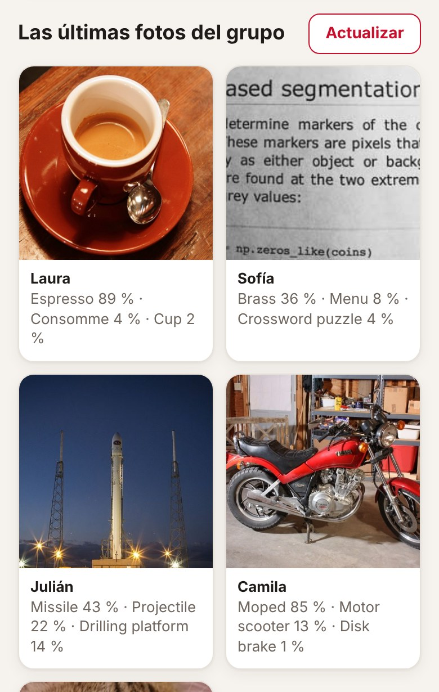 |

Las capturas salen de una prueba local: Cloud Storage simulado y, en lugar de Vision, un modelo de clasificación pequeño corriendo en el computador. Por eso las etiquetas de las capturas no son las de Vision; las reales las vas a ver cuando lo despliegues.

## Arquitectura al terminar la práctica

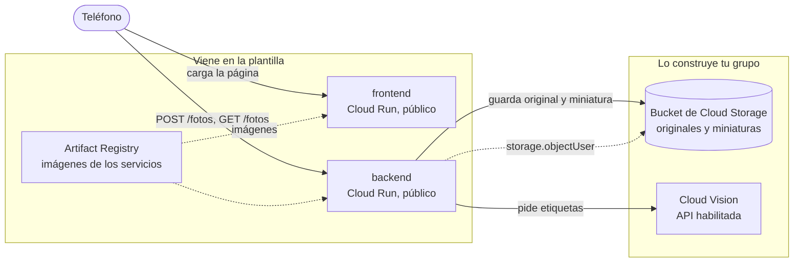

La flecha punteada es el único permiso de IAM que da tu grupo: la cuenta del backend puede crear, leer y listar objetos en ese bucket y en ningún otro. Para llamar a Vision no hace falta ningún rol: basta con que la API esté habilitada en el proyecto y con que el backend corra con una cuenta de servicio del mismo proyecto.

En la plantilla, la variable `BUCKET` del backend está vacía: responde que no tiene dónde guardar y no guarda nada. Es lo primero que vas a ver al desplegar.

## Estructura del repositorio

```
backend/main.py            API en Flask: recibe la foto, hace la miniatura, pide etiquetas y guarda en el bucket
backend/requirements.txt   Dependencias del backend con versión fija
backend/Dockerfile         Imagen del backend con gunicorn
frontend/index.html        La página: subir una foto, ver sus etiquetas y la galería del grupo
frontend/server.py         Servidor sin dependencias que inyecta BACKEND_URL en la página
frontend/Dockerfile        Imagen del frontend
infra/providers.tf         Versión de Terraform y del proveedor de Google
infra/variables.tf         Proyecto, prefijo, región e imágenes
infra/main.tf              APIs, registro, backend y frontend con sus cuentas
infra/outputs.tf           Ruta del registro y URL de los servicios
infra/terraform.tfvars.example   Ejemplo de valores; cópialo como terraform.tfvars
docs/api.md                Endpoints del backend y cómo se guardan las fotos
docs/capturas/             Capturas de la aplicación usadas en este README
.gitignore                 Deja por fuera el estado de Terraform, tus tfvars y __pycache__
```

## Cómo empezar

### Flujo de trabajo

1. Crea el repositorio de tu grupo con **Use this template** en GitHub.
2. Edita en VS Code o en github.dev (tecla `.` en la página del repositorio).
3. Haz commit y push desde el editor.
4. En Cloud Shell clonas la primera vez y traes los cambios con `git pull` después. Desde Cloud Shell nunca haces push.
5. Docker y Terraform se ejecutan siempre en Cloud Shell. La consola de Google Cloud es para mirar y diagnosticar, no para crear recursos.

### Primer despliegue

En Cloud Shell:

```bash
git clone https://github.com/<tu-usuario>/<tu-repositorio>.git
cd <tu-repositorio>/infra
cp terraform.tfvars.example terraform.tfvars
cloudshell edit terraform.tfvars
```

En `terraform.tfvars` pon el ID de tu proyecto y el prefijo del grupo, y ajusta las rutas de las imágenes a esos mismos valores. Este archivo vive solo en Cloud Shell: el `.gitignore` evita que llegue a GitHub.

El orden importa, porque las imágenes necesitan el registro y los servicios necesitan las imágenes:

```bash
# 1. Solo el registro (y las APIs de las que depende)
terraform init
terraform apply -target=google_artifact_registry_repository.registro

# 2. Las imágenes
REGISTRO=$(terraform output -raw registro)
gcloud auth configure-docker us-central1-docker.pkg.dev --quiet
cd ..
docker build -t $REGISTRO/backend:v1 backend
docker push $REGISTRO/backend:v1
docker build -t $REGISTRO/frontend:v1 frontend
docker push $REGISTRO/frontend:v1

# 3. Todo lo demás
cd infra
terraform apply
terraform output
```

Abre `url_frontend` en el teléfono. Si usas otra región, cambia `us-central1` en el comando de `gcloud auth configure-docker`, y ten en cuenta que la cuota gratuita de Cloud Storage solo aplica en `us-central1`, `us-east1` y `us-west1`.

Cuando cambies el código de un servicio, construye y sube la imagen con una etiqueta nueva (`v2`, `v3`...), actualízala en `terraform.tfvars` y vuelve a aplicar. Si subes otra vez la misma etiqueta, Terraform no ve ningún cambio y Cloud Run sigue con la versión anterior.

## Probar cada servicio con `docker run`

Antes de subir una imagen, pruébala en Cloud Shell. Para ver una página servida en Cloud Shell usa **Vista previa en la Web** y elige el puerto.

**Frontend.** No necesita credenciales:

```bash
docker run --rm -p 8080:8080 -e BACKEND_URL=https://<url-del-backend> $REGISTRO/frontend:v1
```

Abre la vista previa en el puerto 8080. Si no pasas `BACKEND_URL`, la página va a decir que no pudo hablar con el backend.

**Backend sin bucket.** El contenedor arranca aunque no tenga credenciales, y sin la variable `BUCKET` responde con un error claro:

```bash
docker run --rm -d --name backend -p 8081:8080 $REGISTRO/backend:v1
curl -i localhost:8081/fotos
docker logs backend
docker rm -f backend
```

Debe responder `503` con el error en JSON y una advertencia en los registros.

**Backend con bucket.** Cuando el bucket ya existe y la API de Vision está habilitada, puedes darle al contenedor tus propias credenciales:

```bash
gcloud auth application-default login
docker run --rm -d --name backend -p 8081:8080 \
  -e GOOGLE_CLOUD_PROJECT=<tu-proyecto> \
  -e BUCKET=<nombre-del-bucket> \
  -e GOOGLE_APPLICATION_CREDENTIALS=/adc.json \
  -v $HOME/.config/gcloud/application_default_credentials.json:/adc.json:ro \
  $REGISTRO/backend:v1
curl -X POST localhost:8081/fotos -F "autor=Ana" -F "foto=@una-foto.jpg"
curl localhost:8081/fotos
```

Los detalles de cada endpoint están en [docs/api.md](docs/api.md).

---

# Informe del grupo

## Integrantes

| Nombre | Código | Usuario de GitHub |
|---|---|---|
| Beymar Jefrey Villamizar Estevez | 1152426 | Beymarjefreyve |
| Luisangel Ferizzola Roa | 1152409 | LouisFzz |
| Angel Johany Vesga Sarmiento | 1152381 | angelvesga |

Beymar despliega con su proyecto de Google Cloud.

## URL de la aplicación

Frontend: https://beyluan-frontend-ivd2fmc7ia-uc.a.run.app

Backend: https://beyluan-backend-ivd2fmc7ia-uc.a.run.app

La aplicación debe estar funcionando el día de la revisión.

## Diagrama propio

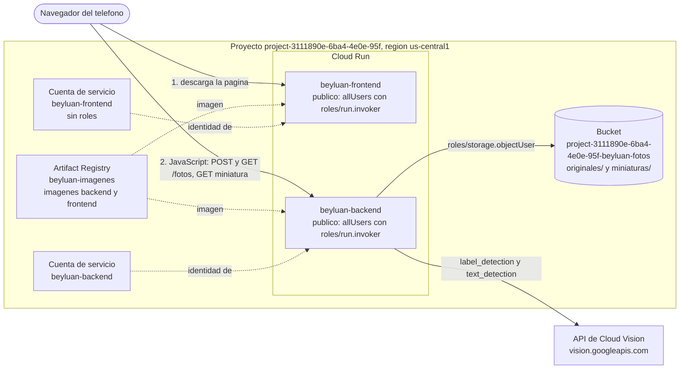

El camino de una foto, según el código:

1. El teléfono pide la página al frontend. `server.py` solo escribe `BACKEND_URL` dentro del HTML; el frontend no llama a ningún otro servicio.
2. El JavaScript de la página corre en el navegador y manda `POST /fotos` (foto y autor) directamente al backend. Con ese mismo origen pide `GET /fotos` y cada miniatura.
3. El backend reduce la foto a una miniatura JPEG de 1024 px y la manda dos veces a Cloud Vision: `label_detection` para las etiquetas y `text_detection` para el texto.
4. Con la cuenta `beyluan-backend` y el permiso `roles/storage.objectUser`, guarda `originales/<id>.<ext>` y `miniaturas/<id>.jpg`. Autor, etiquetas, estado de Vision y texto van como metadatos de la miniatura, en la misma subida.
5. Responde 201 con el JSON de la foto. La página lo muestra y vuelve a pedir la galería, que sale de un solo listado de `miniaturas/`.

## Evidencias por fase

### Fase 0: repositorio, proyecto y configuración

Creamos el repositorio público desde la plantilla y agregamos a los colaboradores; la gráfica de contribuidores muestra tres autores con un commit cada uno. Beymar despliega con su proyecto `project-3111890e-6ba4-4e0e-95f`. Usamos el prefijo `beyluan` y la región `us-central1`, una de las tres con cuota gratuita de Cloud Storage. En Cloud Shell solo hicimos `git clone` y `git pull`; el push siempre salió desde el editor. La segunda captura muestra el `terraform.tfvars` con proyecto, prefijo y rutas de imagen (etiqueta `v1`), el árbol de git limpio y el proyecto activo de `gcloud config list`.

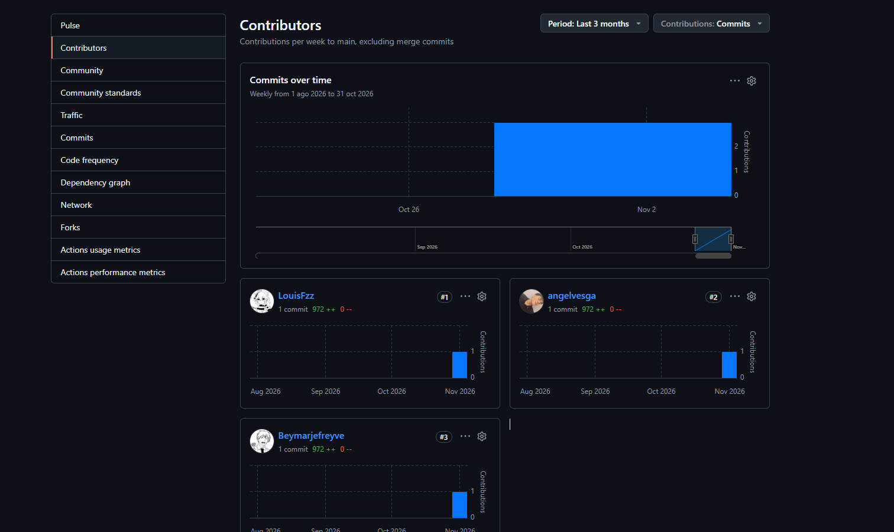

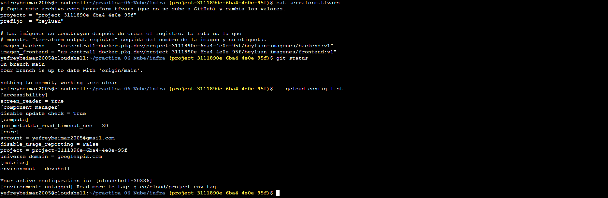

### Fase 1: registro, imágenes y servicios sin bucket

Aplicamos primero solo el registro (`terraform apply -target=google_artifact_registry_repository.registro`), que creó `beyluan-imagenes`. Luego construimos `backend:v1` y `frontend:v1`, etiqueta que mantuvimos de la fase 1 a la 5, y aplicamos el resto. Con `BUCKET` todavía vacío, el backend respondió 503 y dejó en los registros "BUCKET está vacía: no hay dónde guardar las fotos"; el teléfono mostró "El backend no tiene un bucket configurado".

El backend no puede guardar las fotos en su disco porque en Cloud Run el sistema de archivos vive en memoria y se pierde cuando la instancia se detiene. Además pueden correr hasta tres instancias a la vez (`max_instance_count = 3`), cada una con su propio disco, y una foto guardada en una no la vería otra. Por eso las fotos van a un bucket.

El `docker push` desde Cloud Shell falló una y otra vez con `connect: connection refused` hacia `us-central1-docker.pkg.dev`. La cuenta es `roles/owner`, `gcloud auth configure-docker` estaba configurado y el registro respondía por `curl` (HTTP 401); `docker buildx` tampoco pudo descargar su imagen. Para seguir declaramos `cloudbuild.googleapis.com` en la lista de APIs de `infra/main.tf` y construimos las imágenes con `gcloud builds submit` (builds `a82bc149` del backend y `d38458cd` del frontend). Cloud Build usa un bucket de preparación, `project-3111890e-6ba4-4e0e-95f_cloudbuild`, que no está en Terraform, y mostró un aviso informativo de que su cuenta no tiene el rol Logs Writer. No afectó las imágenes y no otorgamos ningún permiso a mano. El resto lo creó solo Terraform.

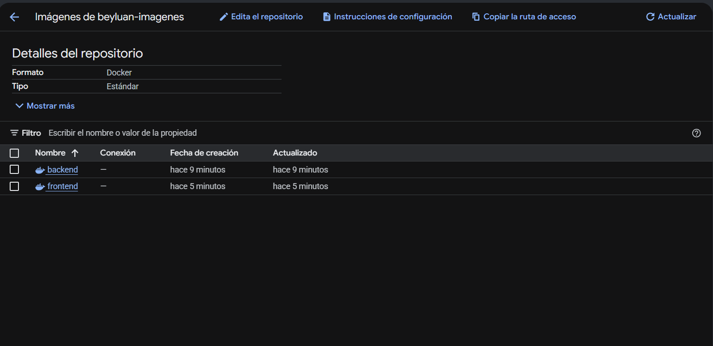

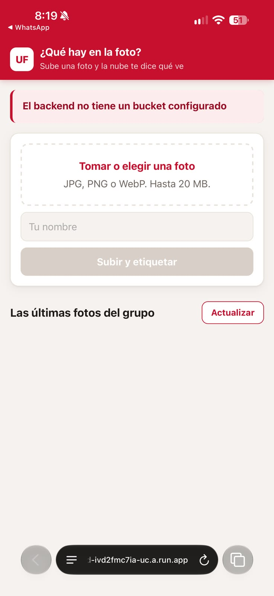

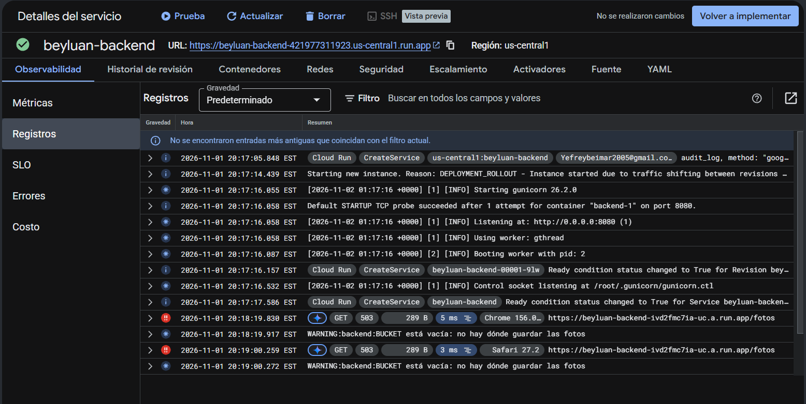

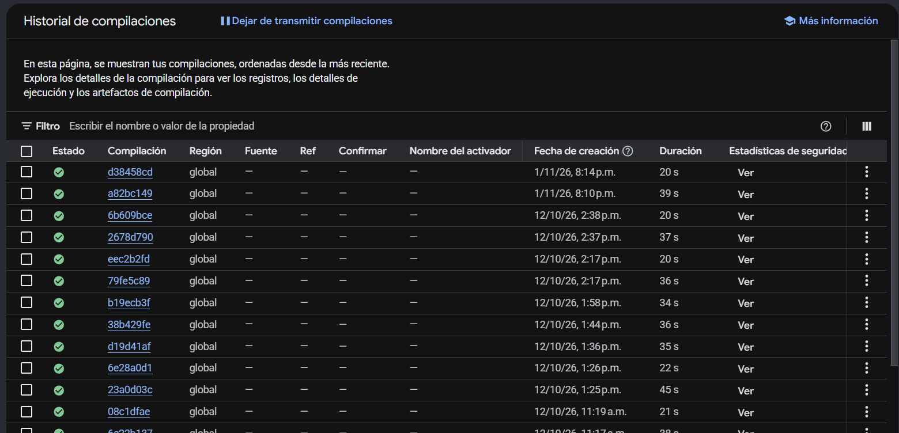

### Fase 2: bucket y permiso del backend

`infra/storage.tf` crea el bucket `project-3111890e-6ba4-4e0e-95f-beyluan-fotos` (STANDARD, `uniform_bucket_level_access`, `public_access_prevention = "enforced"` y `force_destroy`) y el permiso `roles/storage.objectUser` de la cuenta del backend sobre ese bucket, con `google_storage_bucket_iam_member`. `main.tf` pasa `BUCKET` al backend por referencia y `outputs.tf` expone `bucket`. La foto `20261102-020131-ea2b3f` se guardó con 0 etiquetas: el registro muestra `POST 201` y enseguida "Vision no respondió: 403", porque la API de Vision aún no estaba habilitada. La galería la muestra como "sin etiquetas".

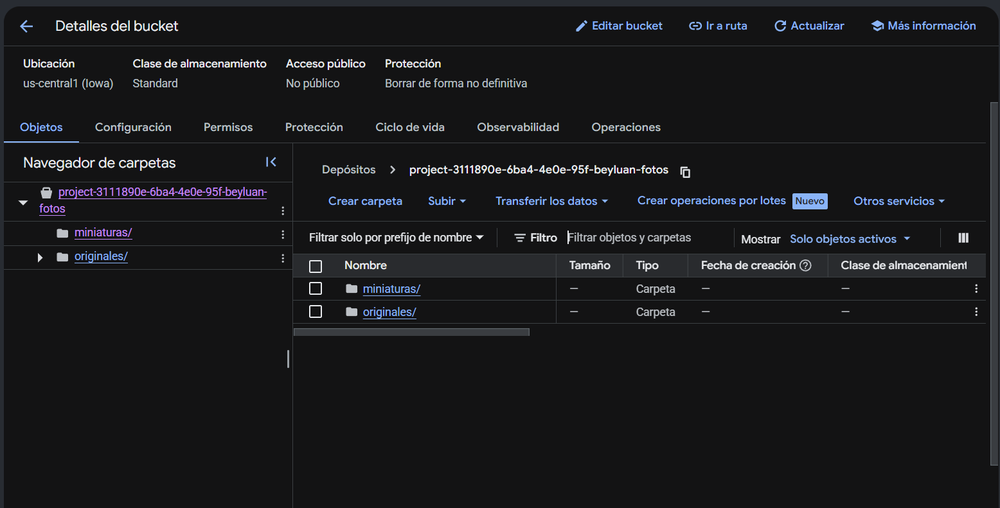

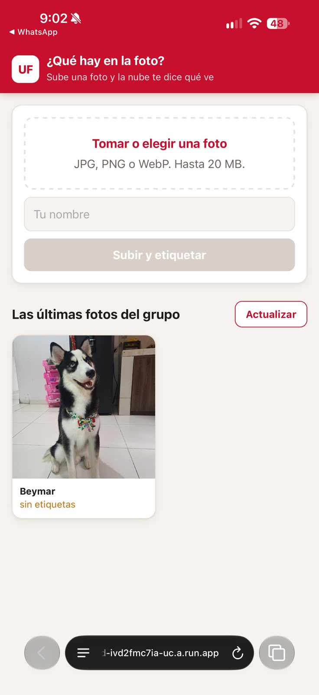

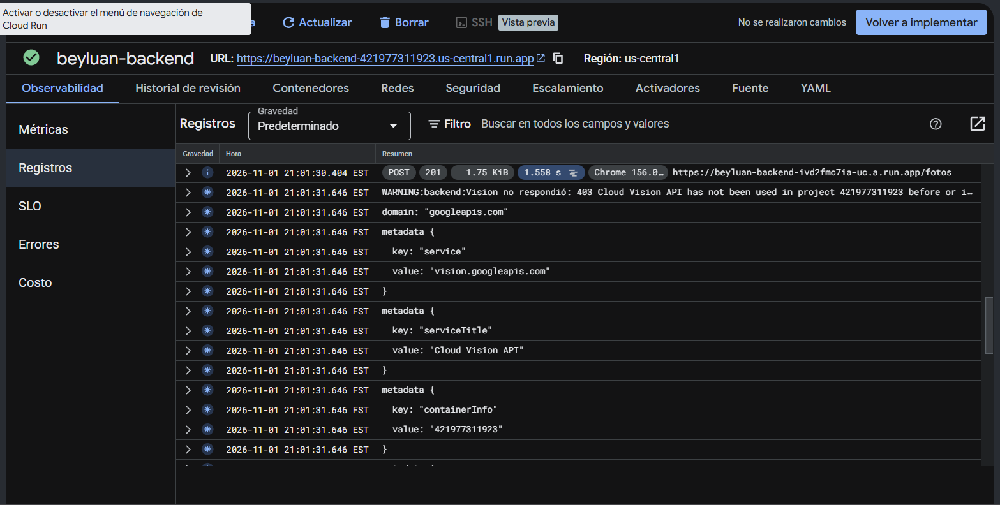

### Fase 3: Vision habilitada

Agregamos `"vision.googleapis.com"` a `google_project_service.apis`: una línea y ningún permiso nuevo, porque la cuenta del backend llama a Vision sin rol propio. Desde el teléfono subimos la foto de un trofeo, id `20261102-022043-a248f9`, autor Beymar. Vision devolvió 8 etiquetas: Award 97 %, Trophy 91 %, Brass 86 %, Medal 79 %, Silver 73 %, Gold 72 %, Bronze 60 % y Emblem 59 %. Bronze y Emblem, con confianza menor a 0,7, salen en ámbar (`e.confianza < 0.7` en `index.html`), y todas las etiquetas llegan en inglés. Los registros del backend dejan `Foto 20261102-022043-a248f9 guardada por Beymar, 8 etiquetas`, y la métrica de la API muestra una solicitud a Cloud Vision sin errores.

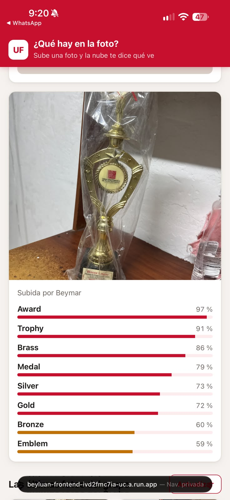

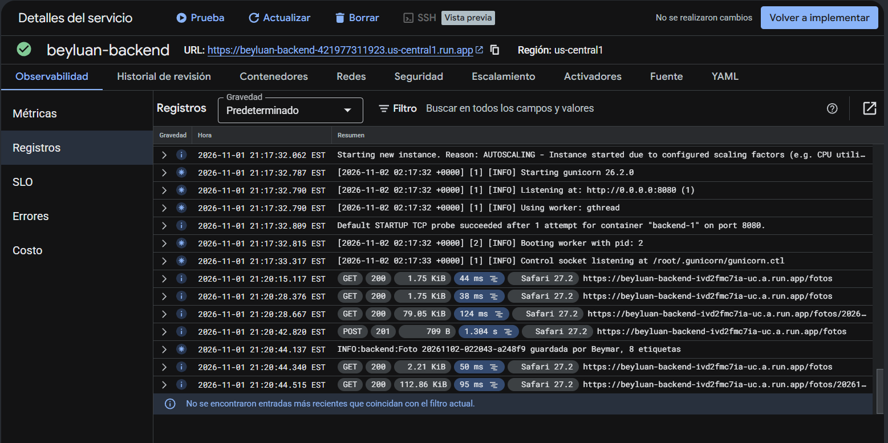

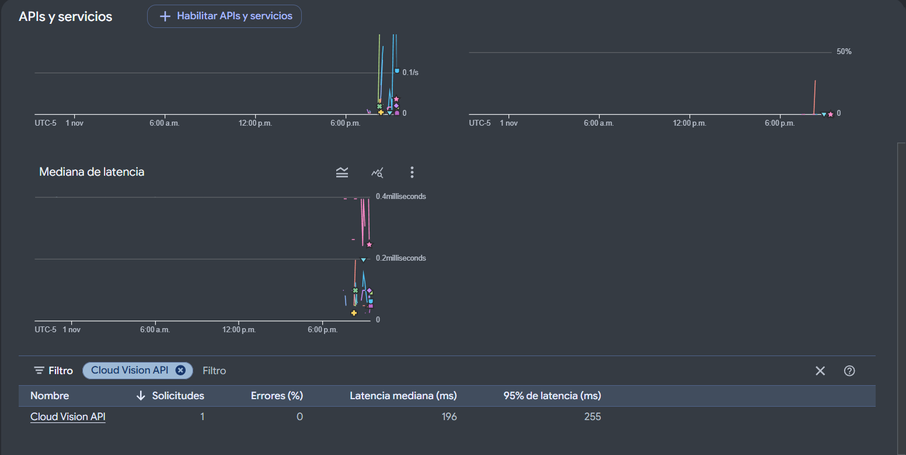

### Fase 4: pruebas con cinco fotos

De las fotos que aparecen en la galería escogimos cinco, una por categoría. Las etiquetas están transcritas tal como las muestra la galería, con la confianza en porcentaje entero. Estas fotos se subieron antes de agregar la lectura de texto del reto, así que ninguna tiene texto leído.

| # | Foto | Subida por | Etiqueta 1 | Etiqueta 2 | Etiqueta 3 | Observación |
|---|---|---|---|---|---|---|
| 1 | Zapato sobre una caja, con buena luz | Beymar | Footwear 98 % | Shoe 97 % | Sneakers 88 % | Las tres etiquetas describen lo que se ve |
| 2 | Destapador con los colores de Colombia | Luis | Logo 75 % | Plastic 69 % | (la galería no muestra una tercera) | Dice logo y plástico, pero no destapador |
| 3 | Dibujo en una hoja de papel | Beymar | Illustration 76 % | Paper Product 75 % | Fictional character 61 % | Describe el dibujo y el papel |
| 4 | Captura de una pantalla con texto | Beymar | Electronic device 98 % | Computer 94 % | Screenshot 93 % | Describe la pantalla; no hay texto leído |
| 5 | Zapato sostenido en la mano, oscuro y desde abajo | Beymar | Shoe 95 % | Sneakers 84 % | Walking Shoe 82 % | Describe el zapato, con menos confianza |

#### Dónde acertó

Con el zapato bien iluminado (foto 1) las tres etiquetas son correctas y con confianza alta, entre 88 % y 98 %. Con la captura de pantalla (foto 4) reconoció el dispositivo, el computador y que era una captura, las tres por encima de 93 %. Son cosas muy comunes en internet, donde el modelo ha visto miles de ejemplos. En el dibujo (foto 3) acertó con Illustration y Paper Product.

#### Dónde se equivocó y por qué

El destapador (foto 2) es el caso más flojo: Logo y Plastic con 75 % y 69 %, y ninguna etiqueta que lo nombre. Es un objeto local y poco común en las imágenes con las que se entrenan estos modelos,. En el dibujo (foto 3), la etiqueta con más confianza es la de ilustración, pero el personaje dibujado solo sale como Fictional character con 61 %, la más baja de la tabla: el modelo describe el dibujo como objeto, no lo que representa. La confianza mide qué tan seguro está el modelo de la etiqueta, no cuánto espacio ocupa el objeto en la foto.

#### Comparación de las fotos 1 y 5

Las dos fotos son de un zapato. En la foto 1, con buena luz y el zapato completo, la primera etiqueta es Footwear con 98 % y Shoe con 97 %. En la foto 5, oscura, desde abajo y con la mano tapando parte, Shoe baja a 95 %, Sneakers a 84 % y aparece Walking Shoe con 82 % en lugar de Footwear. En nuestra prueba la foto oscura no produjo etiquetas vagas como "Light" o "Pattern", pero sí bajó la confianza y cambió el conjunto de etiquetas. La diferencia es pequeña porque el zapato sigue siendo una cosa muy común.

#### La foto con texto

En la foto 4 el modelo etiquetó la imagen como pantalla de computador y captura, pero no leyó lo que decía. Las etiquetas de Vision describen qué hay en la foto, no el texto escrito en ella. Para leer el texto hace falta otra función, `text_detection`, que agregamos después en la fase 6.

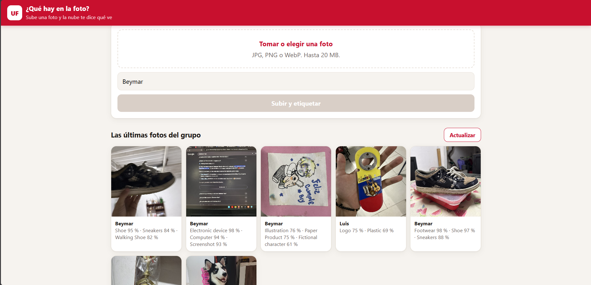

### Fase 5: el bucket por dentro

En un bucket común no existen las carpetas: `originales/` y `miniaturas/` forman parte del nombre de cada objeto, por ejemplo `miniaturas/20261102-023218-7ac9b5.jpg`, y la consola las dibuja cortando por las barras. Cada foto genera dos objetos: el original tal como llegó y una miniatura de 1024 px. La miniatura lleva los metadatos `autor`, `etiquetas` (JSON) y `vision`, que vimos con `gcloud storage objects describe`. La foto `20261102-023218-7ac9b5` (autor Beymar, `vision: ok`) trae Shoe 0,954; Sneakers 0,837; Walking Shoe 0,823; Skate shoe 0,622; Outdoor Shoe 0,609 y Synthetic rubber 0,51.

Medimos dos miniaturas: 58.539 bytes (id `20261102-023218-7ac9b5`) y 80.678 bytes (id `20261102-020131-ea2b3f`). Con `gcloud storage ls -l` vimos que el original de la primera pesa 1.711.088 bytes, así que la miniatura es unas 29,2 veces más liviana (1.711.088 / 58.539).

El backend nunca sirve originales por costo. La salida de Cloud Run hacia Colombia cuesta 0,19 USD por GiB y no tiene cuota gratuita. En el ejemplo de la guía, originales de 3 MB y cien vistas de una galería de 20 fotos suman 6 GB, poco más de un dólar; con miniaturas de unos 100 KB son 200 MB, unos cuatro centavos. La galería tampoco se refresca sola y tiene un botón "Actualizar" porque cada listado del bucket es una operación de clase A y una pestaña abierta no debe gastar cuota.

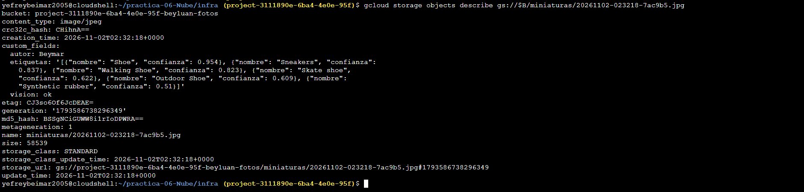

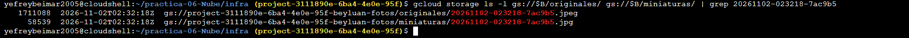

### Fase 6: lectura de texto y limpieza a 7 días

En `backend/main.py`, `leer_texto` llama a `text_detection` sobre la miniatura y toma el primer elemento de `text_annotations`, que trae todo el texto. Junta saltos de línea y espacios repetidos y, si pasa de `MAX_TEXTO = 300` caracteres, lo corta a 299 y agrega "…". Si la foto no tiene texto devuelve cadena vacía; si Vision falla devuelve `None` y deja una advertencia en los registros. `subir()` guarda el resultado en el metadato `texto` de la miniatura, y `como_json` lo devuelve en el campo `texto`.

Construimos las imágenes como `v2` al desplegar el reto y actualizamos la etiqueta en `terraform.tfvars`. En `frontend/index.html`, el resultado de una subida muestra el bloque "Texto que leyó" y cada tarjeta de la galería agrega una línea "Texto: ..." limitada a tres líneas por CSS. En `infra/storage.tf` agregamos una `lifecycle_rule` con acción `Delete` y `age = 7`, sin prefijo, que borra originales y miniaturas de más de 7 días. La consola muestra la regla como "Borrar objeto, 7 días o más desde que se creó el objeto" y avisa que los cambios pueden tardar hasta 24 horas en aplicarse. En la captura del shell, la miniatura `20261102-040631-e85e04` trae el metadato `texto` con lo que Vision leyó de la caja de un celular.

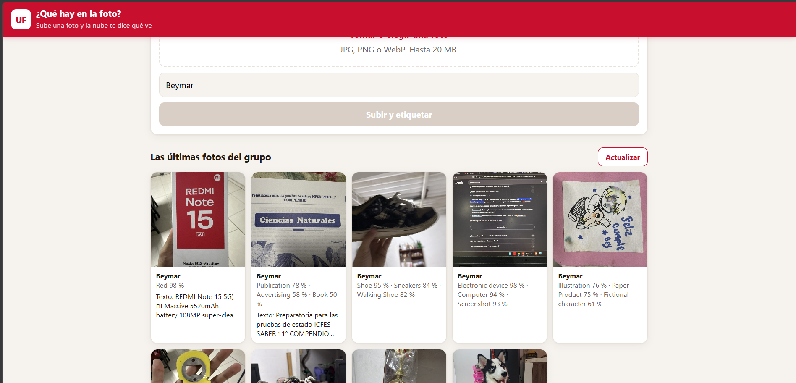

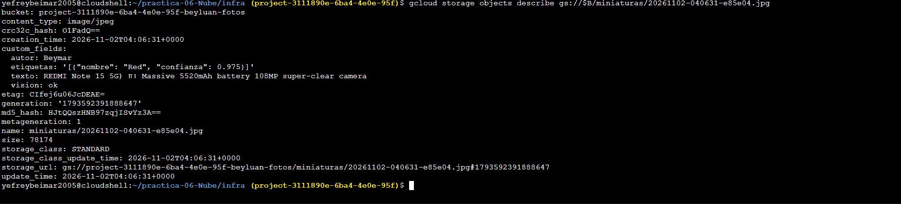

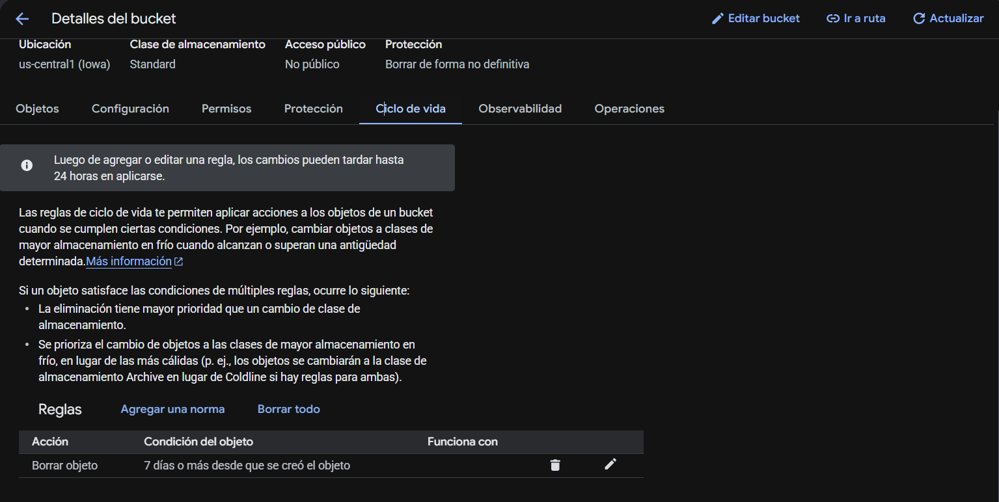

### Incidencias y cómo se resolvieron

- El `docker push` desde Cloud Shell falló con `connection refused`; construimos las imágenes con Cloud Build.
- Un comando de terminal pegado por error dentro de `terraform.tfvars` hizo fallar el plan; reescribimos el archivo con los cuatro valores.
- Al reemplazar los servicios en `main.tf` se perdió el bloque `google_cloud_run_v2_service_iam_member.frontend_publico` y la página respondió 403 hasta que lo restauramos y volvimos a aplicar.
- Un `main.tf` editado en Cloud Shell impidió el `git pull`; descartamos la copia local y traímos la versión del repositorio.

## Decisiones del reto

### 1. Cómo se muestra el texto

Guardamos el texto en el metadato `texto` de la miniatura, con espacios y saltos de línea colapsados y truncado a `MAX_TEXTO = 300` caracteres. Así viaja en la misma subida que las etiquetas y la galería lo recibe en el mismo listado, sin operaciones extra. Si Vision no encuentra texto se guarda una cadena vacía y la galería no muestra nada. Si Vision falla al leer el texto el resultado también queda vacío: `subir()` descarta el error (`texto, _ = leer_texto(...)`) y el metadato `vision` solo refleja las etiquetas, de modo que ese fallo solo se ve en los registros del backend.

Cloud Storage permite 8 KiB (8.192 bytes) de metadatos personalizados por objeto, sumados. El JSON de etiquetas de la foto `7ac9b5` de la fase 5, con seis etiquetas, ocupa 277 bytes. Con ocho etiquetas de nombres de unos 20 caracteres calculamos unos 450 bytes. El texto, con 299 caracteres de hasta 4 bytes en UTF-8 más el "…" de 3 bytes, llega a 1.199 bytes como máximo, y el autor, hasta 40 caracteres, a unos 160. Con las claves y el valor `ok` el peor caso normal queda cerca de 1,9 KB. Si el resto ocupa unos 0,7 KB, quedarían unos 7,4 KB para texto, unos 1.800 caracteres en el peor caso de 4 bytes por carácter. Elegimos 300 por el espacio de la tarjeta de la galería, no por el límite de Cloud Storage.

Cada foto ahora gasta dos unidades de Vision, una por las etiquetas y otra por el texto. En el navegador usamos `textContent` y `createTextNode`, nunca `innerHTML`, para que el texto de una foto no pueda meter HTML en la página. Lo comprobamos con las capturas de la fase 6: la galería muestra las líneas "Texto:" y la miniatura `20261102-040631-e85e04` trae el metadato.

### 2. Regla de ciclo de vida

La `lifecycle_rule` de `infra/storage.tf` tiene condición `age = 7` y acción `Delete`, sin prefijo, así que borra originales y miniaturas juntos. La pestaña Ciclo de vida de la consola la muestra (captura 6b).

Elegimos 7 días porque una semana deja las fotos disponibles hasta la revisión. Con un día se borrarían antes de que alguien las revise, y con 30 se acumula espacio sin necesidad. Un objeto subido el mismo día en que corre la regla no se borra enseguida: su edad cuenta desde la creación y Cloud Storage aplica las reglas de forma asíncrona, así que se borra cuando cumple los 7 días y el borrado puede tardar (la consola habla de hasta 24 horas).

No ejecutamos una prueba de la regla. Se haría con un bucket de prueba y una regla de `age = 1`: se sube un objeto y se revisa a las 24 o 48 horas que ya no esté.

### 3. La cuenta

Lo que hace el código por cada foto subida: escribe el original y la miniatura (2 operaciones de clase A), la página vuelve a listar la galería (1 más) y Vision se llama dos veces (etiquetas y texto). Con esto, y con los pesos de la fase 5 (original de 1.711.088 bytes, miniatura de 58.539 bytes; 1 GB = 10^9 bytes):

| Recurso | Límite | Fórmula y origen de los números | Resultado |
|---|---|---|---|
| Espacio | 5 GB | 5.000.000.000 / (original + miniatura). Pesos de las capturas 5a y 5b | Con 1.711.088 + 58.539 bytes: 2.825 fotos. Con un original de 3 MB: 5.000.000.000 / 3.058.539 = 1.634 fotos |
| Operaciones de clase A | 5.000 al mes | 5.000 / 3 por foto. El 3 sale del código: 2 escrituras y 1 listado tras la subida | 1.666 fotos, sin contar las cargas de página y los clics en Actualizar, que restan operaciones |
| Unidades de Vision | 1.000 al mes | 1.000 / 2 por foto: `label_detection` y `text_detection` | 500 fotos |
| Salida de datos | Sin cuota gratuita; 0,19 USD por GiB | 1 GiB = 1.073.741.824 bytes; una vista de 24 miniaturas de 58.539 bytes pesa 1.404.936 bytes; 1.073.741.824 / 1.404.936 | 764 vistas por GiB, es decir, 0,19 USD cada 764 vistas. Con miniaturas de 80.678 bytes: 554 vistas |

El espacio no se acumula durante el mes: la regla de 7 días deja en el bucket como mucho las fotos de la última semana. La salida de datos no tiene una cuota que se agote, cuesta desde el primer byte. Como el backend manda las miniaturas con `Cache-Control: max-age=86400`, un navegador no las vuelve a descargar durante un día, así que las 764 vistas son un máximo.

Se agota primero Vision: 500 fotos al mes. Las operaciones de clase A alcanzan para 1.666 fotos y el espacio para 2.825 (1.634 con originales de 3 MB), ambos más de tres veces por encima. Con 500 fotos al mes el almacenamiento sería de unos 0,88 GB (500 x 1.769.627 bytes).

### 4. Cómo se reproduce

El orden de creación desde cero es este:

1. `terraform init` y `terraform apply -target=google_artifact_registry_repository.registro`, que crea el registro y las APIs de las que depende.
2. Construir y subir las imágenes del backend y del frontend con la misma etiqueta que tiene `terraform.tfvars` (`v2` en la fase 6). Usamos Cloud Build (`gcloud builds submit`) por lo que pasó en la fase 1.
3. `terraform apply` completo, que crea el bucket, el permiso, las cuentas de servicio, los servicios y el acceso público.

El nombre del bucket sale de `"${var.proyecto}-${var.prefijo}-fotos"`, así que al recrearlo es el mismo, y un bucket recién borrado puede tardar en dejar el nombre disponible. Con `force_destroy = true`, `terraform destroy` borra primero los objetos del bucket y luego el bucket. Sin esa línea el `destroy` fallaría mientras el bucket tenga fotos y habría que vaciarlo a mano. El bucket de preparación de Cloud Build no está en Terraform, así que el `destroy` no lo toca.

Para probar el orden destruimos todo con `terraform destroy`, que terminó con `Apply complete! Resources: 0 added, 0 changed, 14 destroyed.` Después comprobamos que no quedaba nada: `terraform state list` no devolvió recursos y los `gcloud` de servicios de Cloud Run, buckets con `beyluan`, repositorios de Artifact Registry y cuentas de servicio `beyluan` respondieron `Listed 0 items`. Volvimos a crear todo y el último `terraform apply` terminó con `Apply complete! Resources: 8 added, 0 changed, 0 destroyed.` Los outputs devolvieron el mismo bucket (`project-3111890e-6ba4-4e0e-95f-beyluan-fotos`), la misma ruta de registro y las mismas URL del frontend y del backend que teníamos antes.

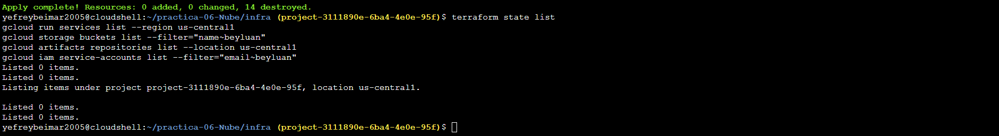

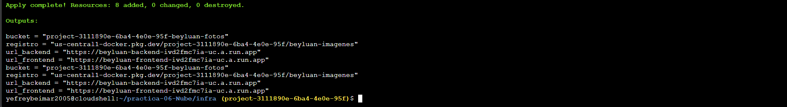

## Preguntas

### ¿Por qué la foto de la fase 2 sigue sin etiquetas después de habilitar Vision, y qué tendría que cambiar en el backend para que las tuviera?

Porque el backend solo llama a Vision dentro de `POST /fotos` y guarda el resultado una vez, en los metadatos de la miniatura. `GET /fotos` solo lee esos metadatos con `list_blobs`, y ningún endpoint reprocesa fotos que ya existen. La foto `20261102-020131-ea2b3f` quedó con `etiquetas` vacío y `vision` con el error 403, y así sigue. Habría que agregar un endpoint o un script que liste las miniaturas con `vision` distinto de `ok`, descargue cada una con `download_as_bytes`, llame a `etiquetar` y `leer_texto` y actualice los metadatos con `blob.patch()`. Cada foto reprocesada costaría una operación de clase B por la descarga, una de clase A por la actualización y dos unidades de Vision, más un listado de clase A para encontrar las candidatas. Volver a subirla desde la página no sirve: crea una foto nueva con otro id.

### Si le quitan el permiso storage.objectUser a la cuenta del backend, ¿qué deja de funcionar, qué ve el usuario y dónde encontrarían el error?

Dejan de funcionar las tres rutas que usan el bucket: subir (`upload_from_string`), listar la galería (`list_blobs`) y bajar miniaturas (`exists` y `download_as_bytes`). El código no captura esas excepciones de Cloud Storage y no hay un manejador para el error 500, así que Flask responde con una página de error que no es JSON. En `index.html`, la función `api()` no encuentra un campo `error` y arma el mensaje "El backend respondió 500". Al subir una foto el usuario lo ve en rojo bajo el formulario; en la galería, en el aviso de arriba; y las miniaturas quedan como imágenes rotas, salvo las que el navegador tenga guardadas del último día. En `subir()` Vision se llama antes de escribir en el bucket, así que cada intento fallido igual gasta sus dos unidades. El error aparece en los registros de Cloud Run del servicio `beyluan-backend`, como una excepción `Forbidden` con un 403 de Cloud Storage y la petición en 500.

### ¿Por qué el backend le manda a Vision la miniatura y no el original?

Hay dos razones. La primera es el peso: el original de la foto `20261102-023218-7ac9b5` pesa 1.711.088 bytes y su miniatura 58.539, unas 29,2 veces menos, de modo que la petición a Vision lleva menos datos y el viaje es más corto. Esto no cambia lo que cuesta Vision, que cobra por unidad y por función, no por el tamaño de la imagen. La segunda es que para etiquetar no hace falta más resolución: el comentario de `subir()` dice que "para etiquetas basta con una imagen pequeña". Además, `hacer_miniatura` ya enderezó la imagen con `ImageOps.exif_transpose` y la convirtió a JPEG, así que Vision recibe la foto en el sentido correcto aunque el teléfono la haya guardado acostada. El original se conserva tal como llegó, pero no se usa para etiquetar.
